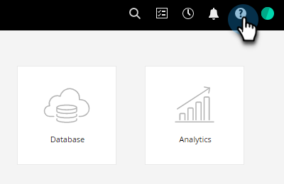
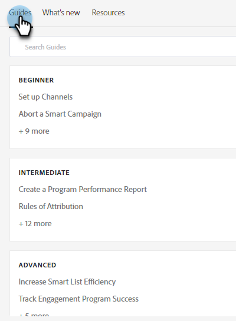
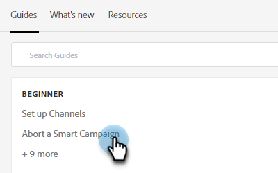
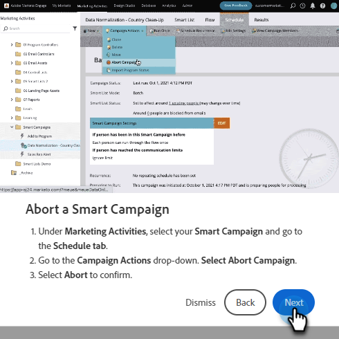
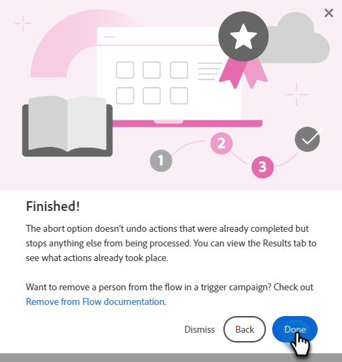
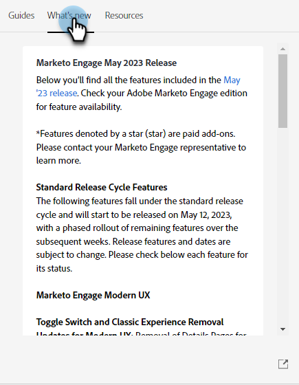
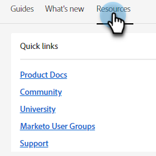

# 說明中心 {#help-center}

Adobe Marketo Engage 內的說明中心是取得協助的集中位置。 除了能向外連結至各種資源 (例如[產品文件](/help/marketo/home.md){target="_blank"}、[版本資訊](/help/marketo/release-notes/current.md){target="_blank"}、[Marketing Nation 社群](https://nation.marketo.com/){target="_blank"}) 之外，還可以存取按照經驗級別分類的實用產品內逐步說明。

## 如何存取 {#how-to-access}

登入Marketo Engage後，按一下「說明」圖示。

### 指南 {#guides}

指南是常用功能的簡易型逐步說明。

1. 按一下所需的指南即可檢視。

   

1. 按一下「**開始使用**」。

   

1. 按一下「**下一步**」，繼續進行。

   

1. 按一下「**完成**」，退出逐步說明。

   

   >[!TIP]
   >
   >您可以隨時按一下「**關閉**」，退出指南。

### 新增功能 {#whats-new}

「新增功能」索引標籤包含Marketo Engage最新版本的完整詳細資料。

>[!TIP]
>
>按一下底部的箭頭圖示，即可在 Experience League 中檢視頁面。

### 資源 {#resources}

「資源」索引標籤讓您可以快速又直接地透過各種方式取得關於 Marketo Engage 執行個體的其他協助。

