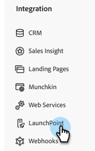

# 將[!DNL Adobe Connect]新增為[!DNL LaunchPoint]服務 {#add-adobe-connect-as-a-launchpoint-service}

Marketo會管理您的[!DNL Adobe Connect]網路研討會註冊與出席情況。

>[!PREREQUISITES]
>
>* 需要[!DNL Adobe Connect]的現有訂閱和管理許可權。 擁有下列詳細資訊：使用者名稱、密碼、參與者密碼和會議資料夾URL。

>[!NOTE]
>
>* **需要管理員權限**
>* 目前不支援[!DNL Adobe Connect On Site]。

1. 在「我的Marketo」中，按一下「**[!UICONTROL Admin]**」。

1. 在&#x200B;**[!UICONTROL Integration]**&#x200B;下，選取&#x200B;**[!UICONTROL LaunchPoint]**。

   

1. 按一下&#x200B;**[!UICONTROL New]**&#x200B;並選取&#x200B;**[!UICONTROL New Service]**。

   

1. 輸入&#x200B;**[!UICONTROL Display Name]**。 在&#x200B;**[!UICONTROL Service]**&#x200B;下拉式清單中，選取&#x200B;**[!UICONTROL Adobe Connect]**。

   

1. 輸入您的&#x200B;**[!UICONTROL Username]**、**[!UICONTROL Access Code]**、**[!UICONTROL Meeting Folder URL]**&#x200B;和&#x200B;**[!UICONTROL Participant Password]**，然後按一下&#x200B;**[!UICONTROL Create]**。

   

   >[!TIP]
   >
   >當您建立參與者密碼時，您選擇的值會在針對事件傳送連結時包含在查詢字串中。 建議您將它設為方便客戶。

   >[!NOTE]
   >
   >在您登入[!DNL Adobe Connect]帳戶後，請選取「**[!UICONTROL Seminars]**」標籤。 無需深入瞭解任何特定研討會，即可將URL從瀏覽器列複製到&#x200B;**[!UICONTROL Meeting Folder URL]**&#x200B;設定。

您的[!DNL Adobe Connect]服務現在已與Marketo Engage同步。

>[!MORELIKETHIS]
>
>瞭解如何[使用 [!DNL Adobe Connect]](/help/marketo/product-docs/demand-generation/events/create-an-event/create-an-event-with-adobe-connect.md){target="_blank"}建立事件。
