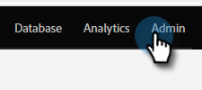
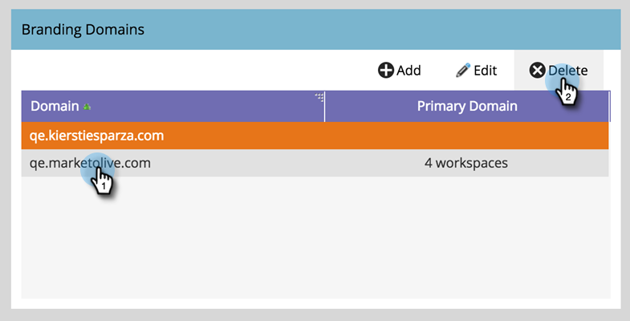

# 刪除品牌化網域 {#delete-a-branding-domain}

1. 前往「**[!UICONTROL Admin]**」區域。

   

1. 按一下「**[!UICONTROL Email]**」。

   

1. 在「品牌化網域」表格中，選取您要移除的網域，然後按一下&#x200B;**[!UICONTROL Delete]**。

   

   >[!NOTE]
   >
   >如果您想要刪除主要品牌領域，您必須先選取不同的品牌領域作為主要品牌領域。
