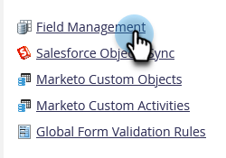
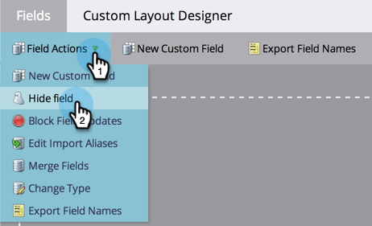

# 在 Marketo 中刪除自訂欄位 {#delete-a-custom-field-in-marketo}

>[!NOTE]
>
>**需要管理員權限**

如果您不再使用某個欄位，則可能想要移除您過去建立的欄位。 很遺憾，您無法刪除Marketo中的欄位，但您可以&#x200B;_在使用者介面中_&#x200B;隱藏它們。

1. 在「我的Marketo」中，按一下「**[!UICONTROL Admin]**」。

   

1. 按一下「**[!UICONTROL Field Management]**」。

   

1. 按一下「**[!UICONTROL Field Actions]**」下拉式選單，選取「**[!UICONTROL Hide Field]**」。

   

   如需詳細的逐步指示，請參閱[隱藏和取消隱藏欄位](/help/marketo/product-docs/administration/field-management/hide-and-unhide-a-field.md)。
