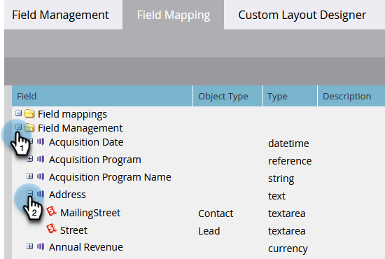

# 檢視Marketo與[!DNL Salesforce]之間的欄位對應 {#view-field-mappings-between-marketo-and-salesforce}

您可能想知道特定Marketo欄位對應至哪些[!DNL Salesforce]欄位。 請遵循下列步驟。

>[!NOTE]
>
>**需要管理員權限**

1. 前往「**[!UICONTROL Admin]**」區域。

   

1. 按一下「**[!UICONTROL Field Management]**」。

   

1. 尋找您感興趣的欄位，然後按一下&#x200B;**+**&#x200B;以展開對應。

   

>[!NOTE]
>
>這會顯示[!DNL Salesforce] API名稱，而非標簽名稱。

>[!IMPORTANT]
>
>列出的欄位僅反映來自初始對應的資料。 在Marketo/[!DNL Salesforce]同步處理後，這些資料不會更新。
