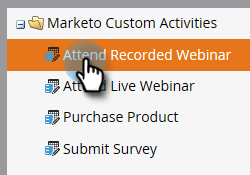
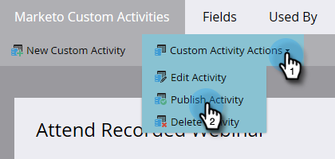
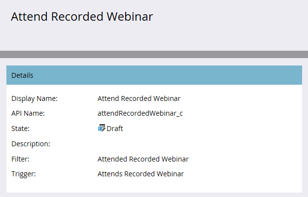

# 發佈自訂活動 {#publish-a-custom-activity}

瞭解如何發佈您的自訂活動。

1. 前往「**[!UICONTROL Admin]**」區域。

   

1. 按一下「**[!UICONTROL Marketo Custom Activities]**」。

   

1. 選取您要發佈的自訂活動。

   

1. 按一下「**[!UICONTROL Custom Activity Actions]**」下拉式選單，選取「**[!UICONTROL Publish Activity]**」。

   

   自訂活動的[!UICONTROL State]變更自[!UICONTROL Draft]...

   

   ...至[!UICONTROL Published]。

   
