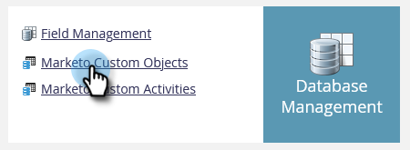
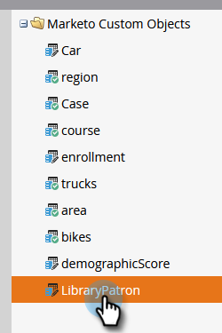
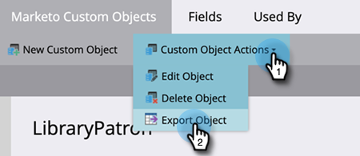
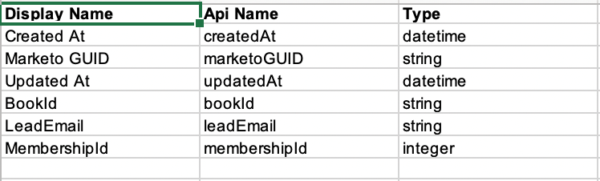
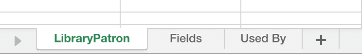

# 自訂物件後設資料匯出 {#custom-object-metadata-export}

如果您使用SOAP API或[!DNL Munchkin] API，則可匯出自訂物件中繼資料結構。 請遵循下列步驟。

>[!AVAILABILITY]
>
>並非所有Marketo Engage使用者都已購買此功能。 如需詳細資訊，請聯絡Adobe客戶團隊（您的客戶經理）。

1. 前往「**[!UICONTROL Admin]**」區域。

   

1. 按一下「**[!UICONTROL Marketo Custom Objects]**」。

   

1. 選取您要匯出的Marketo自訂物件。

   

1. 按一下「**[!UICONTROL Custom Object Actions]**」下拉式選單，選取「**[!UICONTROL Export Object]**」。

   

>[!NOTE]
>
>自訂物件必須處於已核准狀態才能匯出。

您現在有一個試算表，內含三個標籤中的自訂物件架構。

