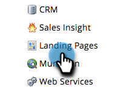
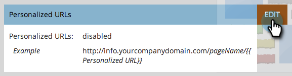
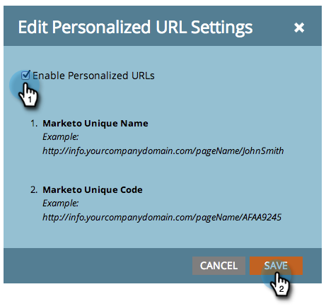

# 啟用您帳戶的個人化 URL {#enable-personalized-urls-for-your-account}

個人化URL對於印刷郵件行銷活動相當實用。

>[!NOTE]
>
>**需要管理員權限**

1. 在「我的Marketo」中，按一下「**[!UICONTROL Admin]**」。

   

1. 按一下「**[!UICONTROL Landing Pages]**」。

   

1. 按一下「**[!UICONTROL Edit]**」。

   

1. 核取&#x200B;**[!UICONTROL Enable Personalized URLs]**&#x200B;方塊並按一下&#x200B;**[!UICONTROL Save]**。

   

現在您已為帳戶啟用PURL，您可以[為個別登入頁面啟用PURL](/help/marketo/product-docs/demand-generation/landing-pages/personalizing-landing-pages/enable-personalized-urls-for-a-landing-page.md)。

>[!NOTE]
>
>如果有兩個人擁有相同的名字/姓氏，系統會自動在結尾附加一個數字。
