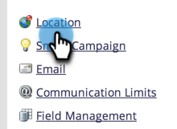
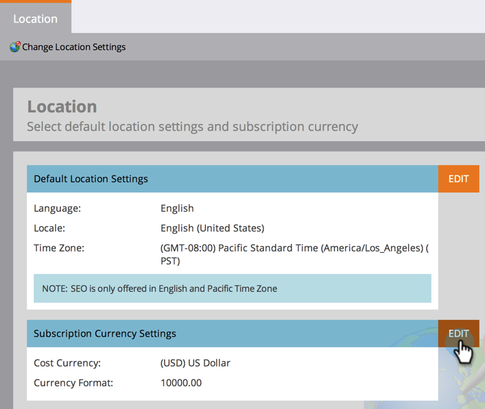
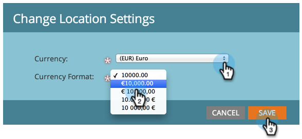

# 設定預設貨幣 {#set-default-currency}

瞭解如何檢視和編輯Marketo Engage訂閱的預設貨幣。

>[!NOTE]
>
>**需要系統管理員許可權。**

1. 前往「**[!UICONTROL Admin]**」區域。

   

1. 按一下「**[!UICONTROL Location]**」。

   

1. 在[!UICONTROL Subscription Currency Settings]中按一下&#x200B;**[!UICONTROL Edit]**。

   

1. 選取您選擇的貨幣格式，然後按一下&#x200B;**[!UICONTROL Save]**。

   
