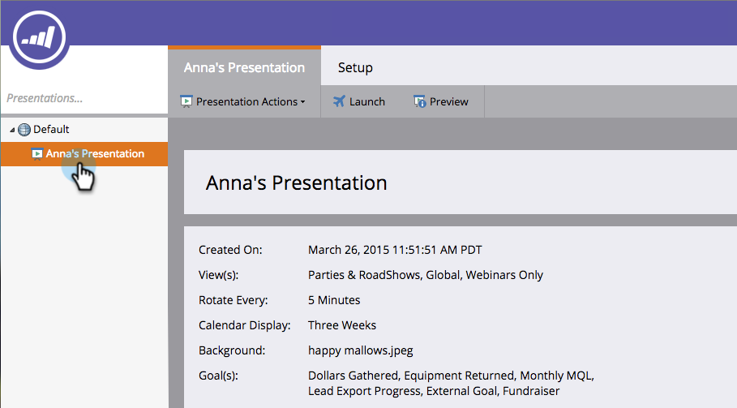
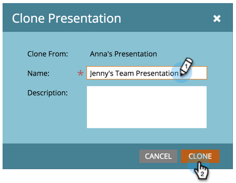

# 原地複製簡報 {#clone-a-presentation}

複製簡報以供不同位置重複使用。

1. 選取您要複製的簡報。

   

1. 用滑鼠右鍵按一下簡報，然後選取&#x200B;**[!UICONTROL Clone]**。

   

1. 輸入複製簡報的名稱，然後按一下&#x200B;**[!UICONTROL Clone]**。

   

   您的簡報現在已有完整復本。
