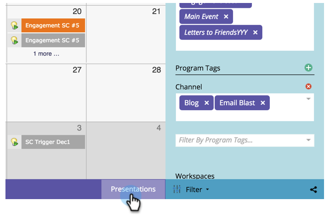
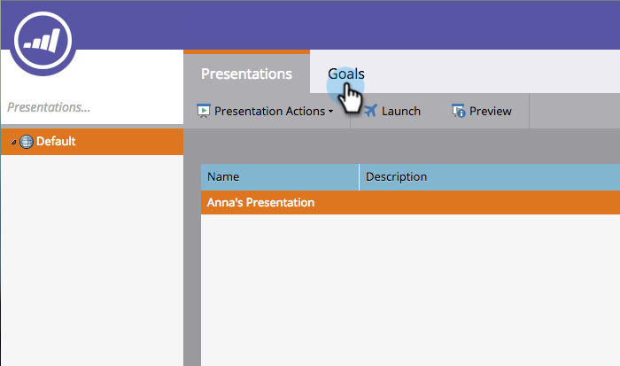
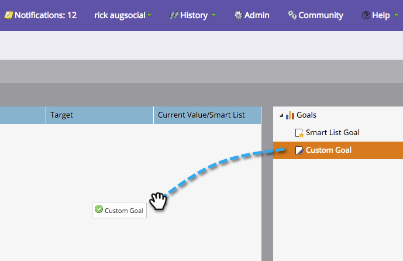
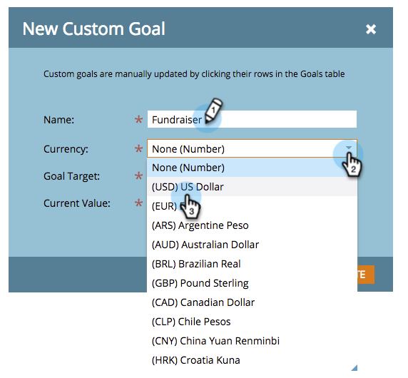
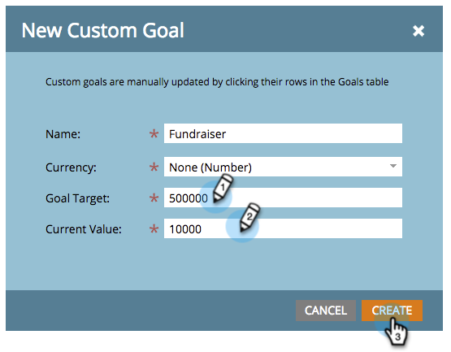
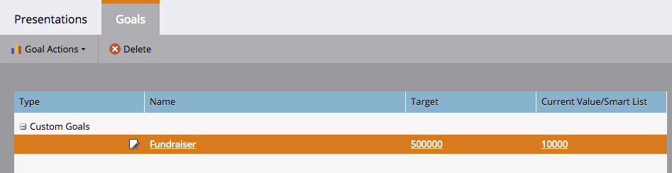

# 建立自訂目標 {#create-a-custom-goal}

目標是追蹤進度和激勵團隊的方法。 建立後，必須手動更新。

如同簡報，目標是[工作區](/help/marketo/product-docs/administration/workspaces-and-person-partitions/understanding-workspaces-and-person-partitions.md)特定的。

1. 移至&#x200B;**[!UICONTROL Calendar]**。

   

1. 按一下右下角的&#x200B;**[!UICONTROL Presentations]**。

   

1. 選取 **[!UICONTROL Goals]** 索引標籤。

   

1. 將&#x200B;**[!UICONTROL Custom Goal]**&#x200B;拖放到畫布中。

   

1. 輸入目標的名稱。 選取&#x200B;**[!UICONTROL Currency]**。

   >[!NOTE]
   >
   >如果目標不是貨幣值，您可以選取&#x200B;**[!UICONTROL None]**。

   

1. 輸入&#x200B;**[!UICONTROL Goal Target]**&#x200B;和&#x200B;**[!UICONTROL Current Value]**&#x200B;的值（如果沒有值，請輸入&#x200B;**0**）。 然後按一下「**[!UICONTROL Create]**」。

   

   已建立您的自訂目標。

   
