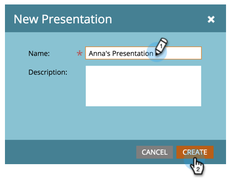

# 建立簡報 {#create-a-presentation}

建立簡報，在HDTV上投影您團隊的行事曆檢視和目標。 簡報是Workspace專屬的。

>[!AVAILABILITY]
>
>
>並非所有Marketo Engage使用者都已購買此功能。 如需詳細資訊，請聯絡Adobe客戶團隊（您的客戶經理）。

1. 移至&#x200B;**[!UICONTROL Calendar]**。

   

1. 按一下右下角的&#x200B;**[!UICONTROL Presentations]**。

   

1. 按一下&#x200B;**[!UICONTROL Presentation Actions]**&#x200B;並選取&#x200B;**[!UICONTROL New Presentation]**。

   

1. 選擇簡報的名稱。 按一下「**[!UICONTROL Create]**」。

   

   簡報現在已準備好進行自訂。

>[!MORELIKETHIS]
>
>[自訂簡報](/help/marketo/product-docs/core-marketo-concepts/marketing-calendar/calendar-hd/customize-a-presentation.md)
