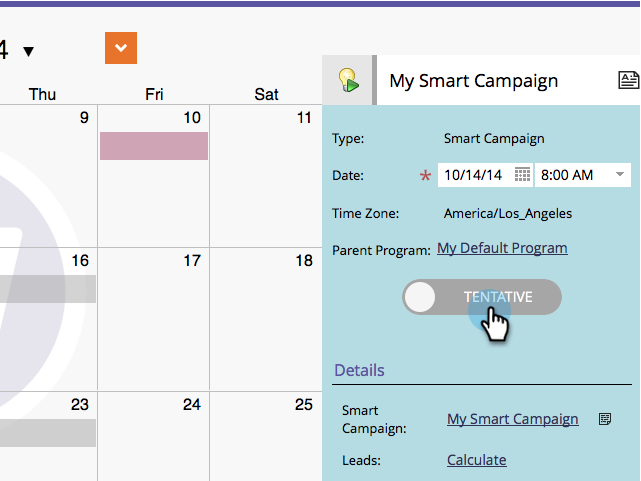

# 直接在行銷行事曆中確認條目 {#confirm-entries-directly-in-the-marketing-calendar}

智慧型行銷活動和電子郵件方案可以建立為暫定專案，且必須確認才能實際發生任何事情。

1. 移至&#x200B;**[!UICONTROL Calendar]**。

   

1. 選取要確認的專案，然後按一下&#x200B;**[!UICONTROL Show Program Focus]**。

   

1. 確認專案。

   

   確認會執行一系列驗證程式，如果一切都已簽出，則會確認該專案。

   
