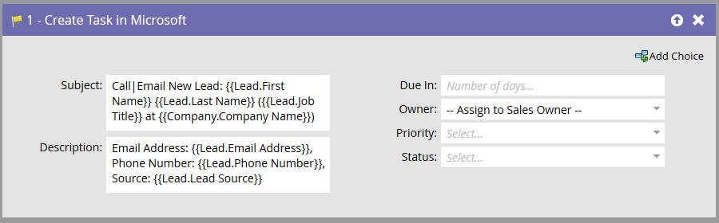

# 在 Microsoft 中建立工作 {#create-task-in-microsoft}

身為行銷人員，您擁有可協助銷售完成交易的資訊。 您可以建立任務，讓他們知道應該做什麼，以及何時應該做。

在Microsoft中建立任務會在[!DNL Microsoft]中與人員（潛在客戶或連絡人）相關的活動下建立任務。

>[!NOTE]
>
>此流程步驟&#x200B;_只有在您的智慧行銷活動中與觸發程式_&#x200B;搭配使用時才有效，不會與篩選器搭配使用。

根據預設，流程步驟將如下所示：

>[!NOTE]
>
>當Marketo Sync使用者建立任務時，**[!UICONTROL Due In]**&#x200B;是將在[!DNL Microsoft]中建立之任務的必要欄位。 如果未輸入值，Marketo預設會輸入五天。

自訂所有欄位，以您想要的方式建立任務。

>[!NOTE]
>
>在「流程動作」中為工作指定的「狀態」欄位會更新[!DNL Microsoft]中的「狀態原因」欄位。

>[!TIP]
>
>您可以在&#x200B;**[!UICONTROL Subject]**&#x200B;和&#x200B;**[!UICONTROL Description]**&#x200B;中使用`{{lead.tokens}}`、`{{company.tokens}}`、`{{campaign.tokens}}`和`{{system.tokens}}`。 如需詳細資訊，請參閱流程步驟](/help/marketo/product-docs/core-marketo-concepts/smart-campaigns/flow-actions/use-tokens-in-flow-steps.md){target="_blank"}的[權杖。
