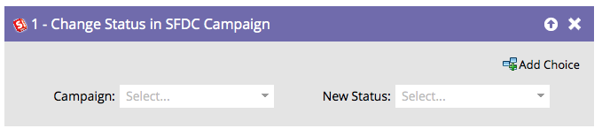
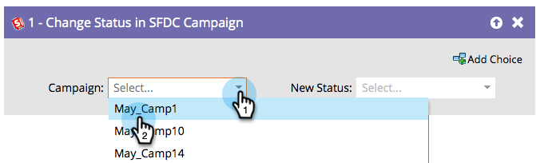
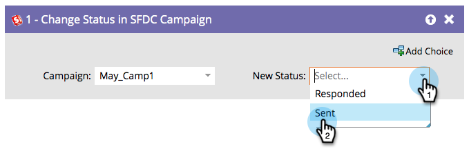

# 在 SFDC 行銷活動中變更狀態 {#change-status-in-sfdc-campaign}

此流程步驟可讓您變更潛在客戶的Salesforce行銷活動會員狀態。

>[!NOTE]
>
>僅在與[!DNL Salesforce]整合時可用。

如果潛在客戶在Salesforce中不存在，或尚未成為促銷活動的成員，則會自動同步該潛在客戶並以適當的狀態新增至Salesforce促銷活動。

1. 首先尋找並選取記錄所在的Salesforce **[!UICONTROL Campaign]**。

   

1. 接著，選取您要設定的&#x200B;**[!UICONTROL New Status]**，然後您就完成了！

   
