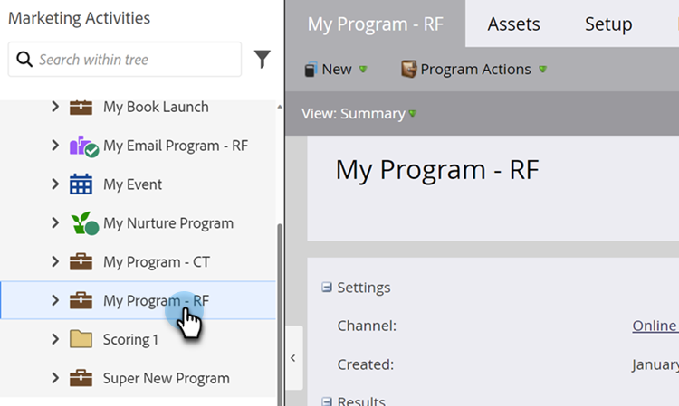

# 建立智慧清單 {#create-a-smart-list}

智慧清單可讓您使用簡單篩選器尋找特定的人員群組。

1. 前往 **[!UICONTROL Marketing Activities]**。

   

1. 選取您要建立智慧列示的程式。

   

1. 在&#x200B;**[!UICONTROL New]**&#x200B;底下，按一下&#x200B;**[!UICONTROL New Local Asset]**。

   

1. 選取「**[!UICONTROL Smart List]**」。

   

1. 輸入&#x200B;**[!UICONTROL Name]**&#x200B;並按一下&#x200B;**[!UICONTROL Create]**。

   

   現在新增並定義一些篩選器。

   >[!MORELIKETHIS]
   >
   >[尋找並新增篩選器至智慧清單](/help/marketo/product-docs/core-marketo-concepts/smart-lists-and-static-lists/creating-a-smart-list/find-and-add-filters-to-a-smart-list.md){target="_blank"}
