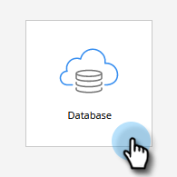

# 手動建立人員 {#create-a-person-manually}

有許多方式可讓人進入Marketo Engage。 若要手動建立一個，請遵循下列步驟。

>[!CAUTION]
>
>Marketo不支援包含emoji的電子郵件地址。

1. 移至&#x200B;**[!UICONTROL Database]**。

   

1. 在&#x200B;**[!UICONTROL New]**&#x200B;底下，按一下&#x200B;**[!UICONTROL New Person]**。

   

1. 輸入人員資訊，然後按一下&#x200B;**[!UICONTROL Create]**。

   
