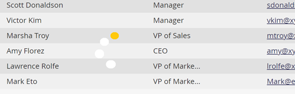

# 重新整理清單或智慧清單 {#refresh-a-list-or-smart-list}

如果您已執行「智慧列示」且已經過數分鐘，結果現在可能會不同 — 請重新整理以找出答案。

## 重新整理結果 {#refresh-results}

1. 若要更新智慧清單&#x200B;**[!UICONTROL People]**&#x200B;索引標籤中的資料，請按一下重新整理圖示。

   

1. 「智慧清單」會重新執行，並顯示最新的結果集。

   

>[!TIP]
>
>有時候，當您執行智慧清單並稍後返回清單時，您可能會在右下角的人數前面看到「關於」這個字。 這表示該數字是近似值 — 按一下計數本身即可重新整理，並取得更新且精確的計數。

>[!MORELIKETHIS]
>
>[從清單或智慧清單匯出人員至Excel](/help/marketo/product-docs/core-marketo-concepts/smart-lists-and-static-lists/managing-people-in-smart-lists/export-people-to-excel-from-a-list-or-smart-list.md){target="_blank"}
