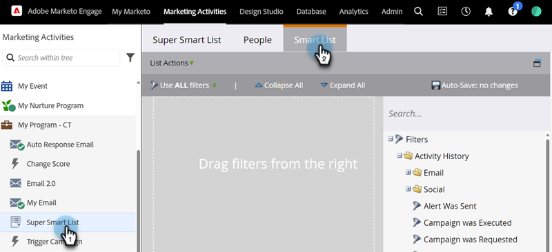

# 在智慧清單中使用閒置狀態篩選器 {#use-inactivity-filters-in-a-smart-list}

使用非使用中篩選器來尋找未執行任何動作的智慧清單中的人員。

1. 前往 **[!UICONTROL Marketing Activities]**。

   

1. 選取您要編輯的智慧列示，然後按一下&#x200B;**[!UICONTROL Smart List]**&#x200B;標籤。

   

1. 尋找並拖曳您選擇的不使用中篩選器至畫布。 例如，此範例會尋找未造訪過您任何頁面的人。

   

   >[!TIP]
   >
   >**[!UICONTROL Inactivity Filters]**&#x200B;資料夾中有許多篩選器。 搜尋「否」並檢視。

1. 選取&#x200B;**[!UICONTROL is any]**&#x200B;運運算元。 這會找出過去30天內未造訪過任何頁面的所有人員。

   
