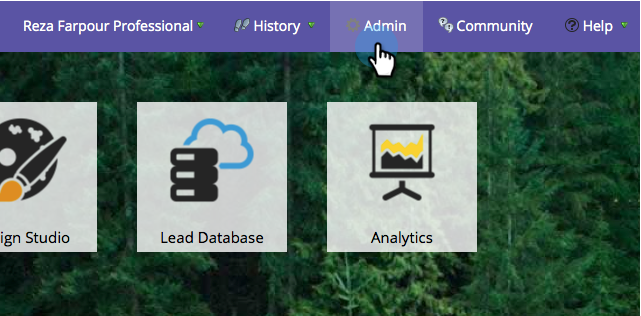
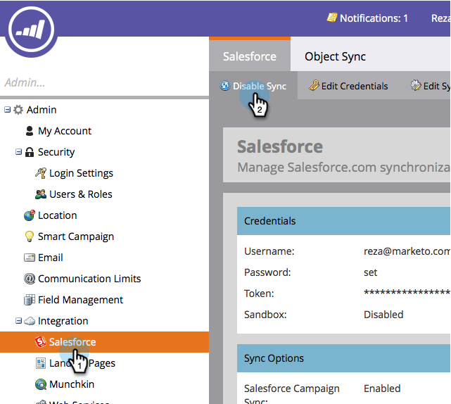
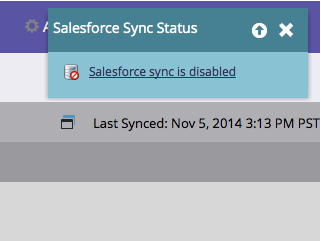

# 啟用/停用[!DNL Salesforce]同步處理 {#enable-disable-the-salesforce-sync}

對同步處理或欄位設定進行重大變更時，您應該在設定時停用同步處理。 方法如下：

1. 移至&#x200B;**[!UICONTROL Admin]**&#x200B;區段。

   

1. 在&#x200B;**[!UICONTROL Salesforce]**&#x200B;底下，按一下&#x200B;**[!UICONTROL Disable Sync]**。

   

1. 雙向同步現在已關閉且處於非使用狀態，直到您重新啟用為止。 [!DNL Salesforce]個流程動作將繼續運作。

   

1. 進行變更並重新啟用同步。 這是相同的按鈕。
