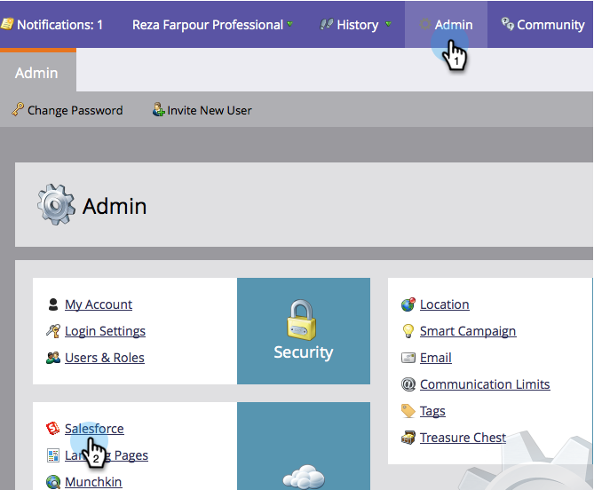
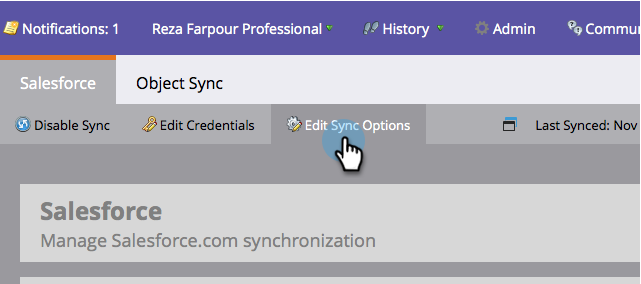
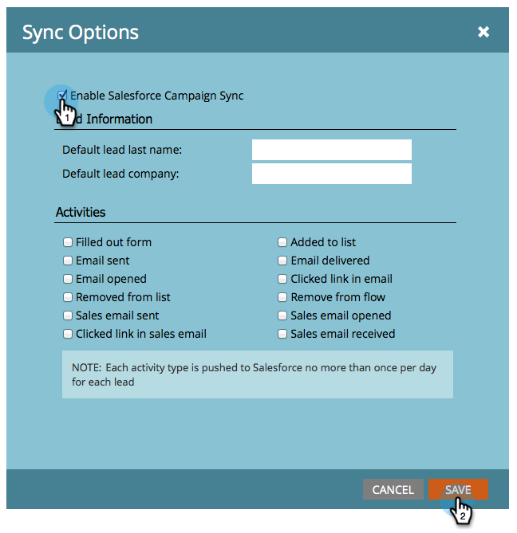

# 啟用/停用行銷活動同步 {#enable-disable-campaign-sync}

>[!NOTE]
>
>**需要管理員許可權**

此選項可讓Marketo Engage將其方案會員資格和狀態與Salesforce行銷活動同步，反之亦然。

1. 移至&#x200B;**[!UICONTROL Admin]**&#x200B;並按一下&#x200B;**[!DNL Salesforce]**。

   

1. 按一下「**[!UICONTROL Edit Sync Settings]**」。

   

1. 檢查&#x200B;**[!UICONTROL Enable Salesforce Campaign Sync]**&#x200B;並按一下&#x200B;**[!UICONTROL Save]**。

   

同步可能需要一些時間才能從Salesforce提取資料。

>[!MORELIKETHIS]
>
>* [SFDC同步： Campaign同步](/help/marketo/product-docs/crm-sync/salesforce-sync/sfdc-sync-details/sfdc-sync-campaign-sync.md){target="_blank"}
>* [設定預設潛在客戶姓氏和公司值](/help/marketo/product-docs/crm-sync/salesforce-sync/setup/optional-steps/set-default-person-last-name-and-company-name.md){target="_blank"}
>* [自訂活動同步](/help/marketo/product-docs/crm-sync/salesforce-sync/setup/optional-steps/customize-activities-sync.md){target="_blank"}
