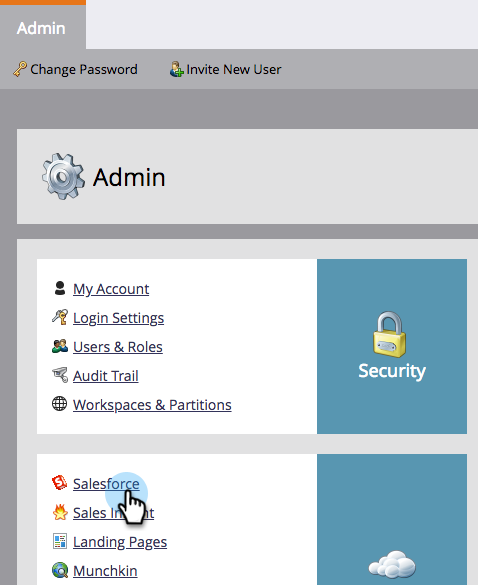

# 關閉傳送給商機所有者的電子郵件通知 {#turn-off-email-notifications-to-lead-owner}

您可以在銷售機會指派時停用在[!DNL Salesforce]中傳送給銷售機會擁有者的自動電子郵件通知。 方法如下。

1. 前往 **[!UICONTROL Admin]**。

   

1. 按一下「**[!DNL Salesforce]**」。

   

1. 在&#x200B;**[!UICONTROL Sync Options]**&#x200B;底下，按一下&#x200B;**[!UICONTROL Edit]**。

   

1. 取消勾選&#x200B;**[!UICONTROL Send email notification to owner in Salesforce upon lead assignment]**&#x200B;方塊。 按一下「**[!UICONTROL Save]**」。

   
