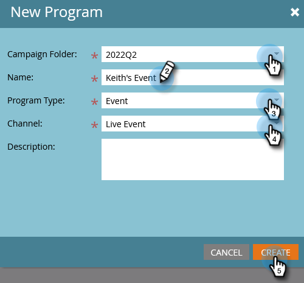
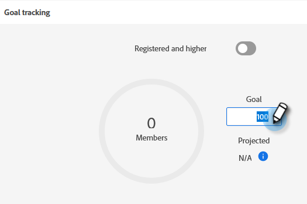

# 設定事件目標 {#setting-event-goals}

為事件提供特定目標，並瞭解其執行情形。

>[!IMPORTANT]
>
>並非每個人都購買過此功能。 如需詳細資訊，請聯絡Adobe客戶團隊（您的客戶經理）。

1. 建立事件程式。

   

1. 選擇[!UICONTROL Campaign Folder]、提供您的活動[!UICONTROL Name]、選取[!UICONTROL Program Type]和[!UICONTROL Channel]。 完成後請按一下 **[!UICONTROL Create]**。

   

1. 在您的事件中，按一下「**[!UICONTROL Reports]**」標籤。

   

1. 按一下&#x200B;**[!UICONTROL Set a goal]**&#x200B;以輸入[!UICONTROL Registered]的目標。 輸入數字，然後按Enter鍵。

   

   

1. 對[!UICONTROL Attended]重複相同的步驟。

   

>[!NOTE]
>
>事件開始後，您就無法設定目標。

按一下[!UICONTROL Reports]標籤，以檢查您的事件目標狀態。
