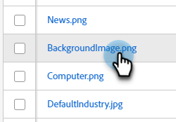
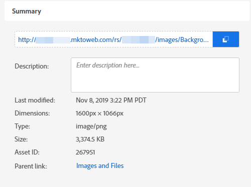

# 尋找已上傳影像或檔案的 URL {#find-the-url-of-an-uploaded-image-or-file}

請依照下列步驟，尋找您上傳之影像或檔案的URL。

1. 移至&#x200B;**[!UICONTROL Design Studio]**。

   

1. 按一下「**[!UICONTROL Images and Files]**」。

   

1. 選取所需的資產。

   

1. **[!UICONTROL URL]**&#x200B;會顯示在詳細資訊頁面上。

   

>[!MORELIKETHIS]
>
>[取代上傳的影像或檔案](/help/marketo/product-docs/demand-generation/images-and-files/replace-an-uploaded-image-or-file.md){target="_blank"}
