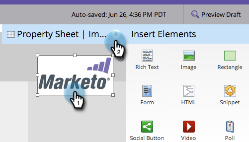

# 新增連結至自由格式登陸頁面影像 {#add-a-link-to-a-free-form-landing-page-image}

>[!PREREQUISITES]
>
>[新增影像至自由形式的登陸頁面](/help/marketo/product-docs/demand-generation/landing-pages/free-form-landing-pages/add-an-image-to-a-free-form-landing-page.md)

>[!NOTE]
>
>這僅適用於自由格式的登陸頁面。

1. 選取您新增至登陸頁面的影像，並展開&#x200B;**[!UICONTROL Property Sheet]**。

   

1. 在&#x200B;**[!UICONTROL linkUrl]**&#x200B;中輸入您的mailto連結。

   

   現在，您的Marketo登陸頁面上有要連結的影像作為郵件。

   
