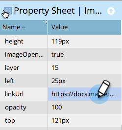

# 新增連結至自由格式登陸頁面中的影像 {#add-a-link-to-an-image-in-a-free-form-landing-page}

若要將登陸頁面上的影像設為可點按的連結，請遵循下列步驟。

>[!PREREQUISITES]
>
>[新增影像至自由形式的登陸頁面](/help/marketo/product-docs/demand-generation/landing-pages/free-form-landing-pages/add-an-image-to-a-free-form-landing-page.md)

1. 按一下您要新增連結的影像。

   

1. 展開&#x200B;**[!UICONTROL Property Sheet]**。

   

1. 將連結複製或輸入到&#x200B;**[!UICONTROL linkUrl]**&#x200B;方塊中。

   

   您已成功將連結新增至登陸頁面上的影像。 您現在可以[預覽頁面](/help/marketo/product-docs/demand-generation/landing-pages/landing-page-actions/preview-a-landing-page.md)以檢視其運作情況。

>[!TIP]
>
>永遠測試您的頁面。
