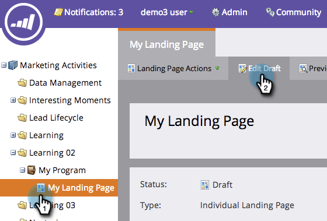

# 新增矩形至自由格式登陸頁面 {#adding-a-rectangle-to-a-free-form-landing-page}

登入頁面上的矩形可用來反白標示或以視覺化方式分隔內容區段。

1. 選取自由格式登陸頁面，然後按一下&#x200B;**[!UICONTROL Edit Draft]**。

   

   >[!NOTE]
   >
   >任意格式的登入頁面設計工具會在新視窗中開啟。

1. 拖曳至&#x200B;**[!UICONTROL Rectangle]**&#x200B;專案上。

   

1. 選取您的矩形並使用&#x200B;**[!UICONTROL Property Sheet]**&#x200B;進行所需的任何變更。

   >[!TIP]
   >
   >您可以使用拖放方式來移動矩形並調整其大小。 同時嘗試鍵盤上的箭頭！ 提示：按下Shift鍵一次移動10px的矩形。

   

您現在可以將矩形新增至自由格式的登入頁面。
