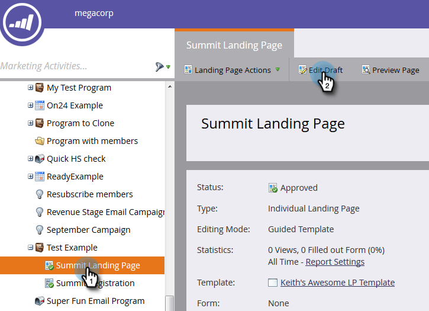
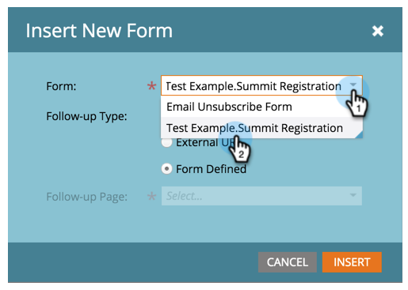
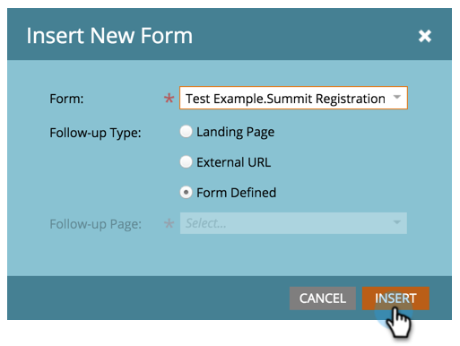
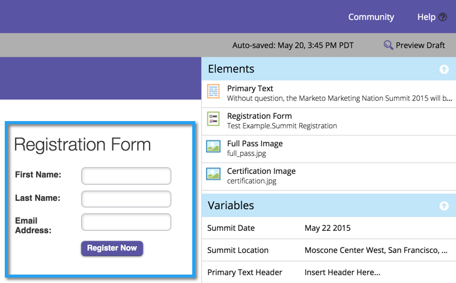

# 新增表單至引導式登陸頁面 {#add-a-form-to-a-guided-landing-page}

>[!PREREQUISITES]
>
>[建立引導式登陸頁面](/help/marketo/product-docs/demand-generation/landing-pages/guided-landing-pages/create-a-guided-landing-page.md)

1. 前往「**[!UICONTROL Marketing Activities]**」區域。

   

1. 尋找並選取您的登入頁面，然後按一下&#x200B;**[!UICONTROL Edit Draft]**。

   

   >[!NOTE]
   >
   >引導式登入頁面中的可用元素由範本定義。 如果您在元素面板中看不到表單，請選取新範本或洽詢範本建立者。

1. 在元素面板中連按兩下&#x200B;**表單**。

   

1. 選取您要新增的表單。

   

1. 選擇後續追蹤頁面時，有三個選項：

   * **[!UICONTROL Landing Page]** — 選取Marketo登陸頁面
   * **[!UICONTROL External URL]** — 挑選您想要的URL
   * **[!UICONTROL Form Defined]** — 使用表單層級定義的設定

   >[!NOTE]
   >
   >後續追蹤頁面是使用者提交表單後所看到的頁面。

1. 在此範例中，選取[!UICONTROL Form Defined]。 按一下「**[!UICONTROL Insert]**」。

   

   

關閉登入頁面編輯器並[核准登入頁面草稿](/help/marketo/product-docs/demand-generation/landing-pages/understanding-landing-pages/approve-unapprove-or-delete-a-landing-page.md)。
