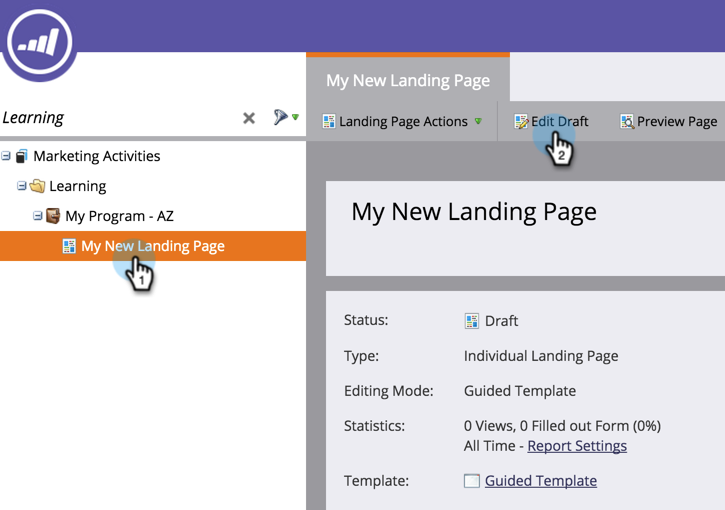
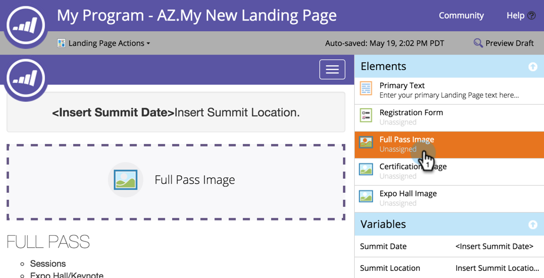
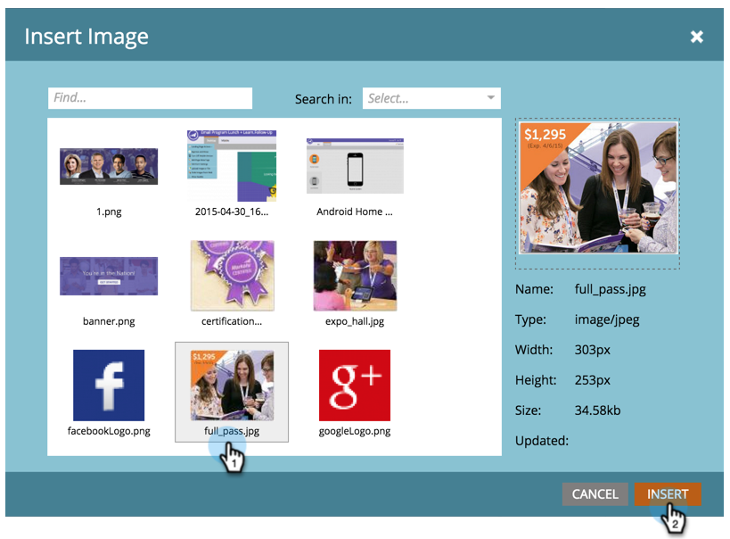
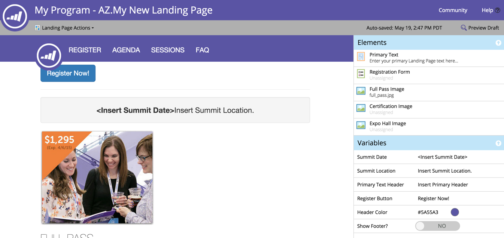

# 新增影像至引導式登陸頁面 {#add-an-image-to-a-guided-landing-page}

與自由格式的登陸頁面不同，引導式登陸頁面有預先定義的鎖定空間，您可在此新增影像。

1. 選取引導式登陸頁面。 按一下「**[!UICONTROL Edit Draft]**」。

   

1. 按一下您要編輯的影像。 元素預留位置會在登入頁面畫布中點亮。

   

1. 選取您想要的影像，然後按一下&#x200B;**[!UICONTROL Insert]**。

   

1. 內容將顯示在元素預留位置中。

   >[!NOTE]
   >
   >影像大小調整方式取決於範本。 深入瞭解[引導式登陸頁面範本](/help/marketo/product-docs/demand-generation/landing-pages/landing-page-templates/create-a-guided-landing-page-template.md)。

   

   >[!TIP]
   >
   >目前不支援在編輯器中指定影像的連結。 請改用RTF文字元素。
