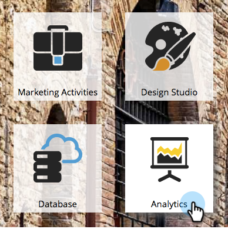
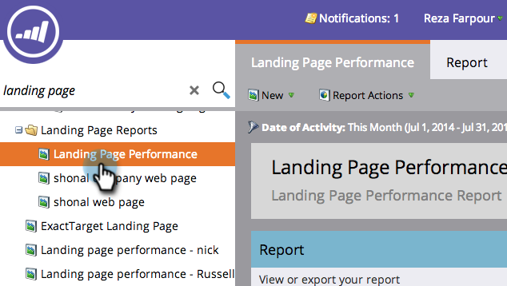
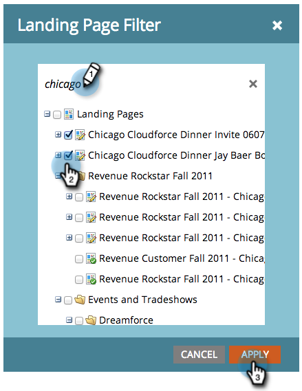
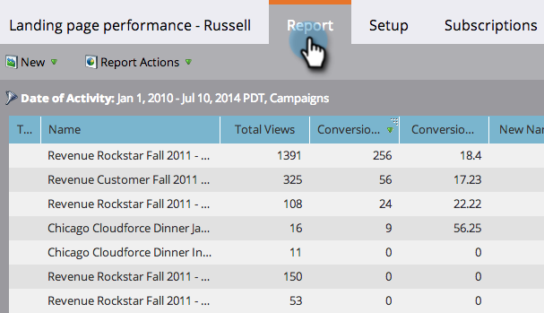

# 篩選登陸頁面效能報告 {#filter-a-landing-page-performance-report}

將[登陸頁面效能報告](/help/marketo/product-docs/demand-generation/landing-pages/understanding-landing-pages/landing-page-performance-report.md)的焦點放在方案（本機資產）中的登陸頁面、[!UICONTROL Design Studio] （全域資產）中的登陸頁面，或已封存的登陸頁面。

1. 移至&#x200B;**[!UICONTROL Analytics]** （或&#x200B;**[!UICONTROL Marketing Activities]**）。

   

1. 從導覽樹狀結構中選取您的登入頁面報表。

   

1. 按一下「**[!UICONTROL Setup]**」索引標籤並拖曳篩選器。

   

   * **[!UICONTROL Design Studio Landing Pages]：**&#x200B;全域資產，在[!UICONTROL Design Studio]中管理。
   * **[!UICONTROL Marketing Activities Landing Pages]：[!UICONTROL Marketing Activities]索引標籤上程式中的**&#x200B;本機資產。
   * **[!UICONTROL Archived Landing Pages]：**&#x200B;非使用中、已淘汰的登陸頁面。

1. 選擇要包含在報表中的資料夾和特定登入頁面。

   

   >[!TIP]
   >
   >如果您選取資料夾，報表會包含報表執行時資料夾所包含的所有內容。

1. 完成了！ 按一下「**[!UICONTROL Report]**」索引標籤以檢視篩選的報告。

   
