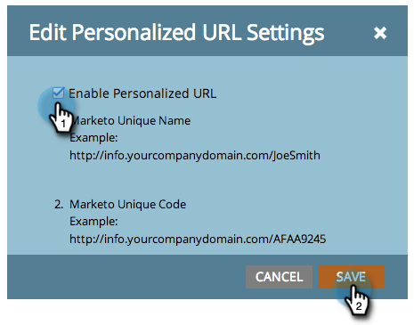

# 啟用登陸頁面的個人化 URL {#enable-personalized-urls-for-a-landing-page}

個人化URL很適合列印郵件行銷活動。

>[!PREREQUISITES]
>
>[為您的帳戶啟用個人化URL](/help/marketo/product-docs/demand-generation/landing-pages/personalizing-landing-pages/enable-personalized-urls-for-your-account.md)

1. 選取登入頁面，然後按一下&#x200B;**[!UICONTROL Personalized URL]**&#x200B;的設定。

   

1. 現在您可以檢查&#x200B;**[!UICONTROL Enable Personalized URL]**&#x200B;並按一下&#x200B;**[!UICONTROL Save]**。

   

您已為登陸頁面啟用個人化URL。 系統將識別使用該URL的訪客，且Token可正常運作。
