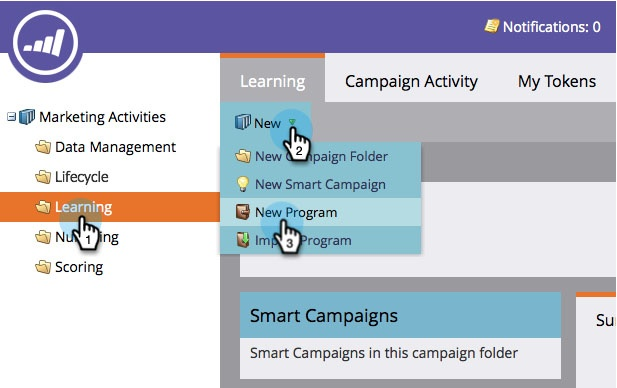
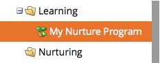

# 建立參與方案 {#create-an-engagement-program}

您可以使用 Marketo 中的參與計畫，輕鬆完成電子郵件培養。

1. 前往 **[!UICONTROL Marketing Activities]**。

   

1. 選取您要建立參與計畫的資料夾，然後按一下 **[!UICONTROL New]** 和 **[!UICONTROL New Program]**。

   

1. 輸入 **[!UICONTROL Name]**，選取 **[!UICONTROL Program Type]** 的 **[!UICONTROL Engagement]**，然後按一下 **[!UICONTROL Create]**。

   

   

   >[!MORELIKETHIS]
   >
   >* [新增內容至資料流](/help/marketo/product-docs/email-marketing/drip-nurturing/creating-an-engagement-program/add-content-to-a-stream.md)
   >* [設定資料流頻率](/help/marketo/product-docs/email-marketing/drip-nurturing/engagement-program-streams/set-stream-cadence.md)
