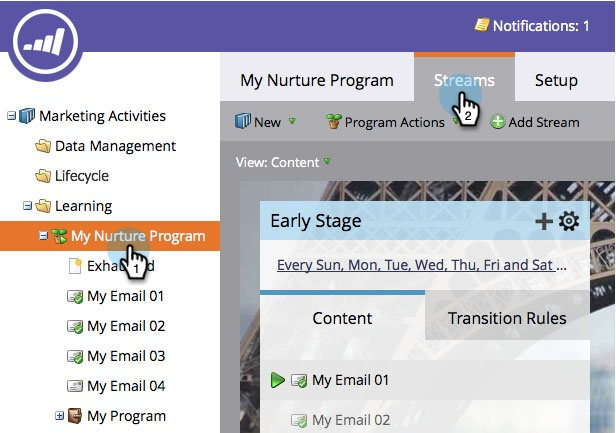
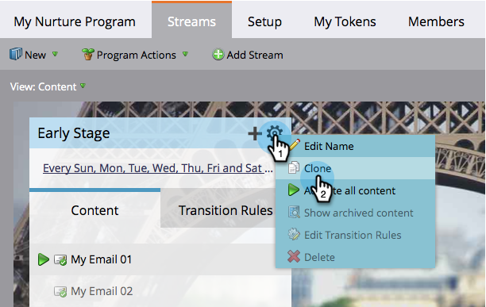
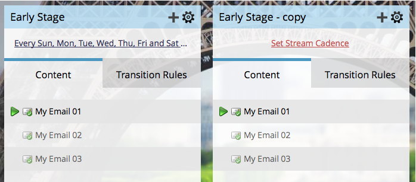

# 原地複製資料流 {#clone-a-stream}

基於各種原因複製資料流，包括測試不同的訂單和不同的步調。

1. 選取您的參與方案，然後前往&#x200B;**[!UICONTROL Streams]**&#x200B;標籤。

   

1. 按一下串流齒輪圖示，然後按一下&#x200B;**[!UICONTROL Clone]**。

   

   >[!NOTE]
   >
   >每個參與計畫最多可以有25個串流。

   

   >[!CAUTION]
   >
   >串流中的所有專案都會複製，但Cadence除外。 請記得設定。
