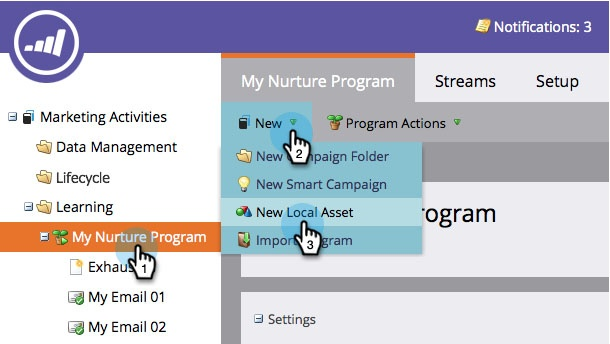
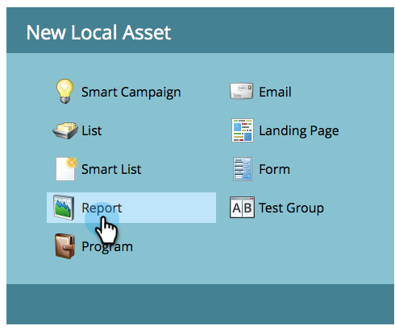
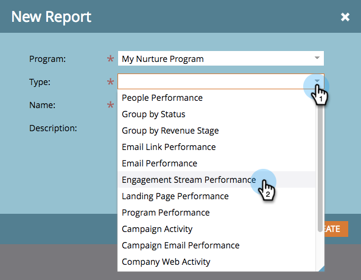
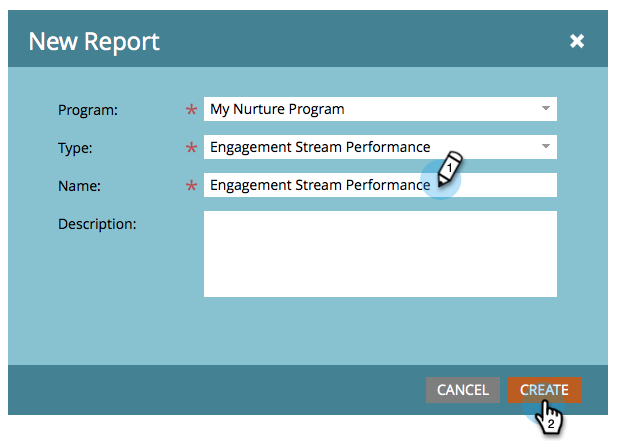
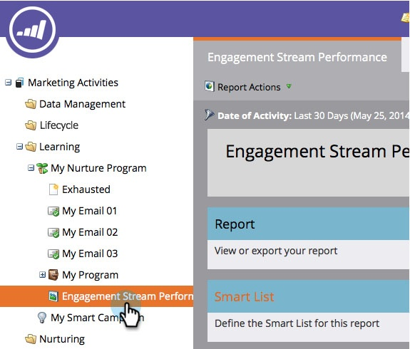
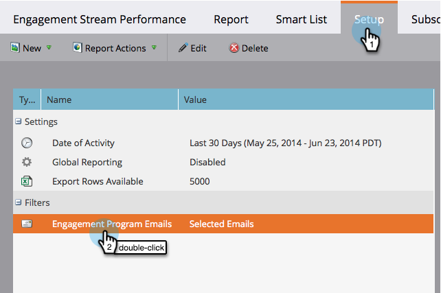
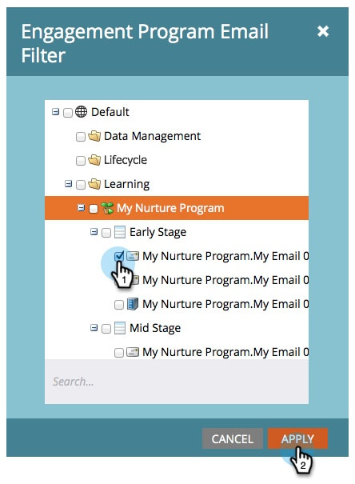
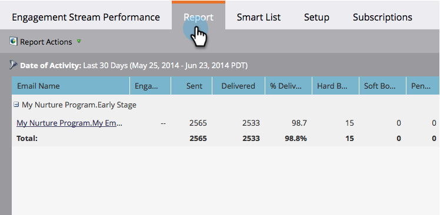

# 參與資料流效能報告 {#engagement-stream-performance-report}

想要瞭解您的參與內容表現如何？ 嘗試參與串流績效報表。

## 建立報告 {#create-the-report}

1. 尋找並選取您的參與方案，然後在&#x200B;**[!UICONTROL New]**&#x200B;底下按一下&#x200B;**[!UICONTROL New Local Asset]**。

   

1. 選取「**[!UICONTROL Report]**」。

   

   >[!TIP]
   >
   >在方案下建立報告會自動將其限制在方案內容內。

   選取&#x200B;**[!UICONTROL Engagement Stream Performance]**&#x200B;作為報告&#x200B;**[!UICONTROL Type]**。
   

1. 為報告命名，然後按一下&#x200B;**[!UICONTROL Create]**。

   

   現在進行設定。

## 編輯設定 {#edit-settings}

1. 尋找並選取您的報表。

   

1. 在&#x200B;**[!UICONTROL Setup]**&#x200B;標籤下，連按兩下&#x200B;**[!UICONTROL Engagement Program Emails]**&#x200B;篩選器。

   

1. 選取您要報告的電子郵件，然後按一下&#x200B;**[!UICONTROL Apply]**。

   

## 執行報告 {#run-report}

1. 若要執行報表，請按一下&#x200B;**[!UICONTROL Report]**&#x200B;標籤。

   

   >[!TIP]
   >
   >參與分數雖然未以圖示說明，但是此報表中的一欄。 請參閱[瞭解參與分數](/help/marketo/product-docs/email-marketing/drip-nurturing/reports-and-notifications/understanding-the-engagement-score.md)以取得相關詳細資訊。

   請注意，報告已依參與方案分組。
