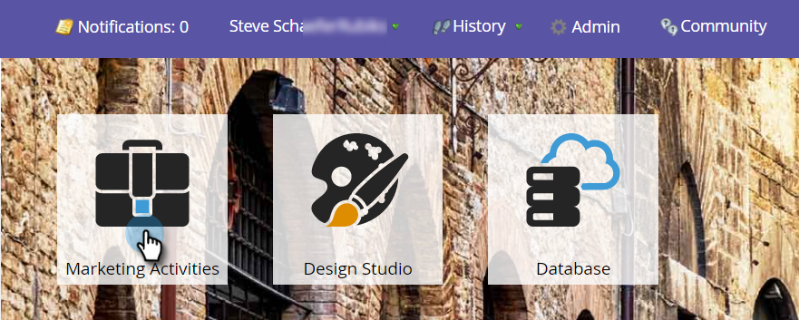
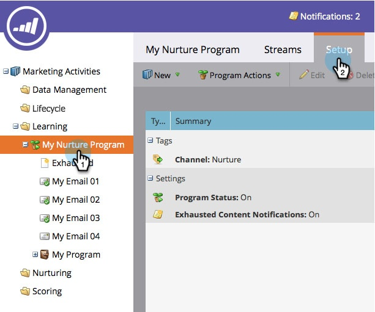
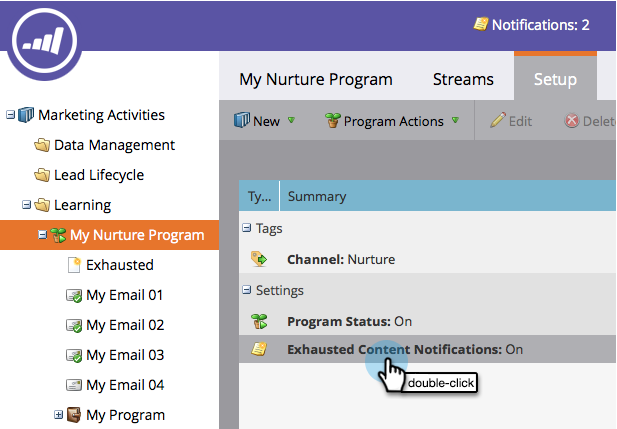
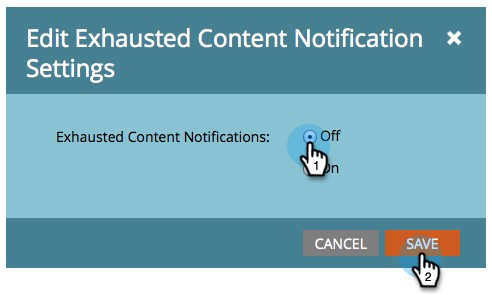

# 停用和啟用內容已用盡通知 {#disable-and-enable-exhausted-content-notifications}

當人們耗盡串流中的所有內容時，Marketo可以傳送通知給您。 您可以根據需求停用/啟用通知。

1. 前往 **[!UICONTROL Marketing Activities]**。

   

1. 選取參與方案，然後按一下&#x200B;**[!UICONTROL Setup]**&#x200B;標籤。

   

1. 連按兩下&#x200B;**[!UICONTROL Exhausted Content Notifications]**。

   

1. 選取&#x200B;**[!UICONTROL Off]** （或&#x200B;**[!UICONTROL On]**）並按一下&#x200B;**[!UICONTROL Save]**。

   

   如果您啟用通知，將會在資料流本身看到一些內容，並收到電子郵件通知。
