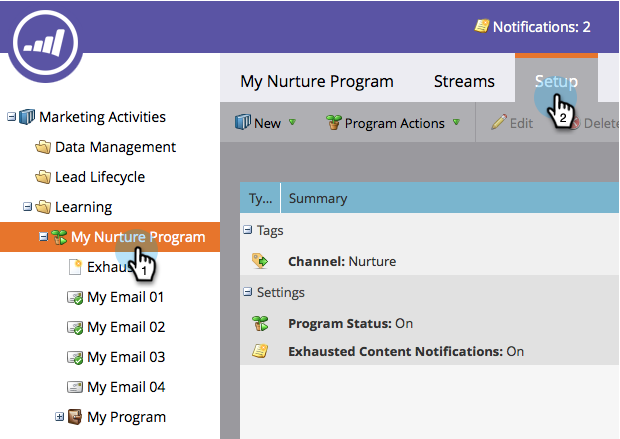
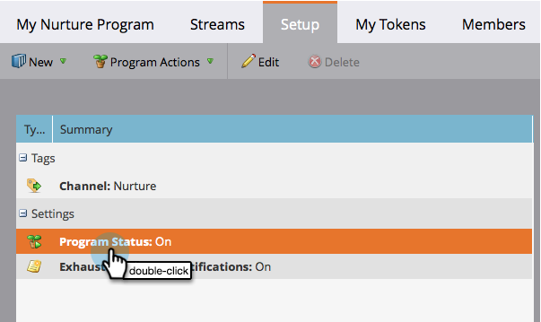
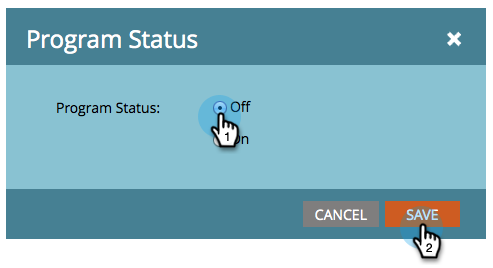

# 開啟和關閉參與方案 {#turn-an-engagement-program-on-and-off}

只要按一下開關，您就可以關閉參與計畫。 這樣會停止傳送任何內容。

1. 前往 **[!UICONTROL Marketing Activities]**。

   

1. 選取參與方案並按一下&#x200B;**[!UICONTROL Setup]**。

   >[!NOTE]
   >
   >除非您已超出訂閱限制，否則參與計畫預設為啟用。

   

1. 連按兩下&#x200B;**[!UICONTROL Program Status]**。

   

1. 選取「**[!UICONTROL Off]**」然後按一下「**[!UICONTROL Save]**」。

   

您可以使用相同的步驟將其重新開啟。
