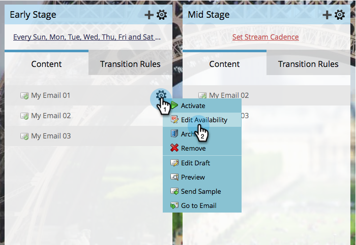
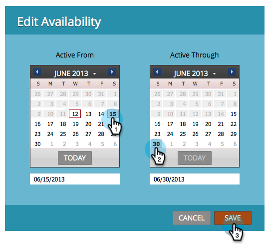
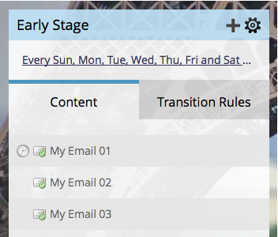

# 編輯資料流內容的可用性 {#edit-availability-of-stream-content}

您可以設定內容在串流中處於作用中狀態的時間範圍。 方法如下。

1. 選取您的參與方案，然後前往&#x200B;**[!UICONTROL Streams]**&#x200B;標籤。

   

1. 按一下您要排程的內容之齒輪圖示，然後選取&#x200B;**[!UICONTROL Edit Availability]**。

   

1. 選取您的&#x200B;**[!UICONTROL Active From]**&#x200B;日期，然後選取&#x200B;**[!UICONTROL Active Through]**&#x200B;日期，再按一下&#x200B;**[!UICONTROL Save]**。

   

   >[!TIP]
   >
   >您可以將&#x200B;**[!UICONTROL Active Through]**&#x200B;保留空白，讓內容永遠可用。

   排程內容旁會出現時鐘圖示。 它會根據您設定的排程變成作用中或非作用中。

   
