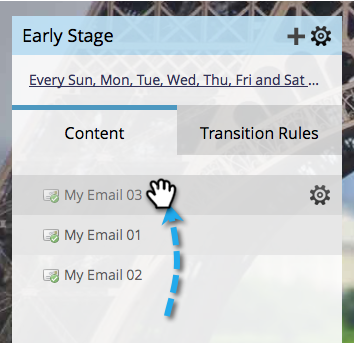

# 決定資料流內容優先順序 {#prioritize-stream-content}

將內容新增到串流後，您可能想要變更優先順序。 內容一律由上而下在每次轉換中傳送，不會將任何內容傳送給同一個人兩次。

1. 前往 **[!UICONTROL Marketing Activities]**。

   

1. 選取您的參與方案，然後按一下「**[!UICONTROL Streams]**」標籤。

   

1. 將內容拖放至您想要的順序。

   

   >[!NOTE]
   >
   >在轉換時，優先順序一律會從上到下讀取。

