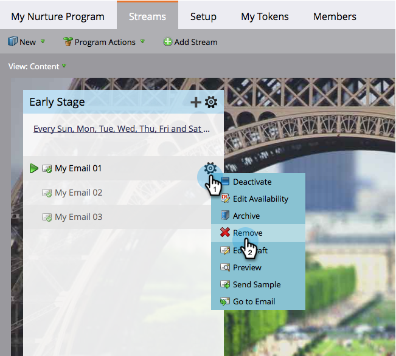

# 移除資料流內容 {#remove-stream-content}

您可以移除或封存內容片段。 與移除串流內容不同，[封存](/help/marketo/product-docs/email-marketing/drip-nurturing/using-stream-content/archive-and-unarchive-stream-content.md)會保留與內容相關的所有歷程記錄。 如果您不介意遺失部分內容的歷史統計資料，但想加以移除，以下提供移除的方式。

1. 前往 **[!UICONTROL Marketing Activities]**。

   

1. 選取您的參與方案，然後按一下&#x200B;**[!UICONTROL Streams]**&#x200B;標籤。

   

1. 將游標暫留在您要移除的內容上，在齒輪圖示出現時按一下，然後按一下&#x200B;**[!UICONTROL Remove]**。

   

   >[!CAUTION]
   >
   >只有在您不關心歷程記錄時才移除內容。 如果要保留歷史記錄，請[封存](/help/marketo/product-docs/email-marketing/drip-nurturing/using-stream-content/archive-and-unarchive-stream-content.md)。

   現在您知道如何移除內容片段了。
