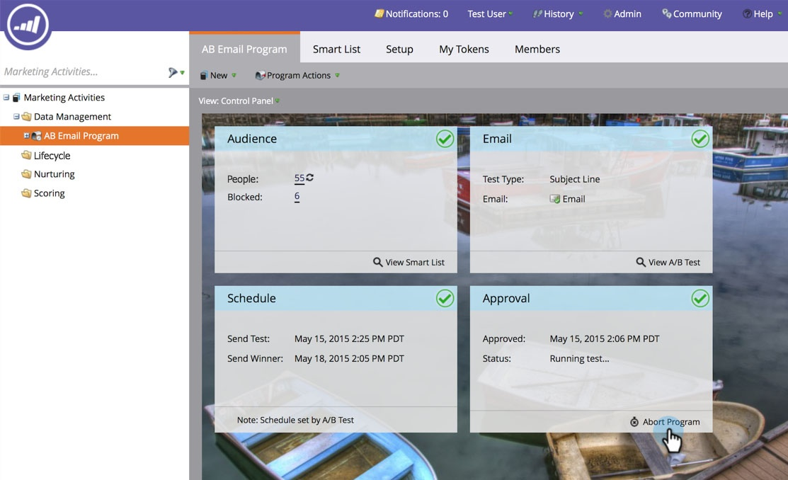
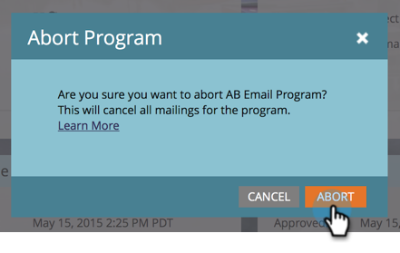
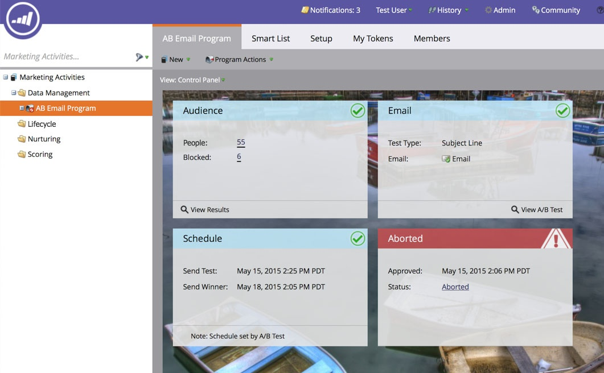

# 中止電子郵件方案 {#abort-email-program}

糟糕！ 踩剎車！ 此電子郵件程式不應該出去。

>[!NOTE]
>
>本文旨在協助您防止電子郵件在傳送前外傳。 無法復原已傳送的電子郵件。

1. 在電子郵件程式中，按一下&#x200B;**[!UICONTROL Abort Program]**。

   

1. 按一下&#x200B;**[!UICONTROL Abort]**&#x200B;以進行完整確認。

   

1. 系統會顯示通知標題，指出此電子郵件程式已中止。

   

   >[!CAUTION]
   >
   >電子郵件程式中止後，即無法重新排程。

哇！ 您不高興可以避免這些代價高昂的錯誤嗎？
