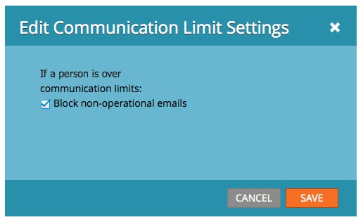

# 在電子郵件方案中啟用/停用通訊限制 {#enable-disable-communication-limits-in-an-email-program}

執行電子郵件程式時，您可以選擇忽略或遵守[管理員層級的通訊限制](/help/marketo/product-docs/administration/email-setup/enable-communication-limits.md)。 以下是其操作方式。

>[!NOTE]
>
>通訊限制在管理員區段[&#128279;](/help/marketo/product-docs/administration/email-setup/enable-communication-limits.md)中設定為，可協助您避免傳送過多電子郵件給某人。

1. 前往 **[!UICONTROL Marketing Activities]**。

   

1. 尋找並選取您的電子郵件程式。

   

1. 在&#x200B;**[!UICONTROL Setup]**&#x200B;標籤下，連按兩下通訊限制條列專案。

   

1. 根據預設，如果達到通訊限制，則會封鎖非作業電子郵件，但如果您要略過這些限制，請清除核取方塊並按一下&#x200B;**[!UICONTROL Save]**。

   

   若保留&#x200B;**[!UICONTROL Block non-operational emails]**&#x200B;核取，將無法傳送電子郵件給收到超過您的管理員設定允許之電子郵件的任何人。
