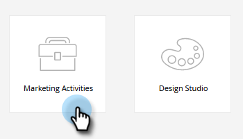
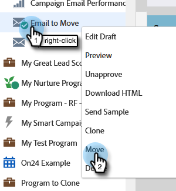
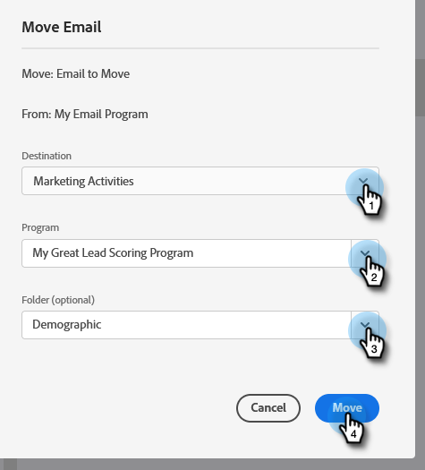
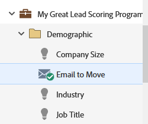

# 移動電子郵件 {#move-an-email}

是否需要將電子郵件從一個計畫移動到另一個計畫？ 方法如下。

1. 前往 **[!UICONTROL Marketing Activities]**。

   

1. 找到您要移動的電子郵件，用滑鼠右鍵按一下並選取&#x200B;**[!UICONTROL Move]**。

   

1. 選取&#x200B;**[!UICONTROL Destination]**、**[!UICONTROL Program]**&#x200B;和選用的&#x200B;**[!UICONTROL Folder]**。 選取「**[!UICONTROL Move]**」。

   

   >[!NOTE]
   >
   >在此範例中，我們正在將電子郵件移至另一個程式，但您也可以將電子郵件移至[!UICONTROL Design Studio]中的資料夾。

   您將看到您的電子郵件現在存在於另一個方案中。

   

   >[!NOTE]
   >
   >您也可以將電子郵件拖放至樹狀結構中的新目的地。
