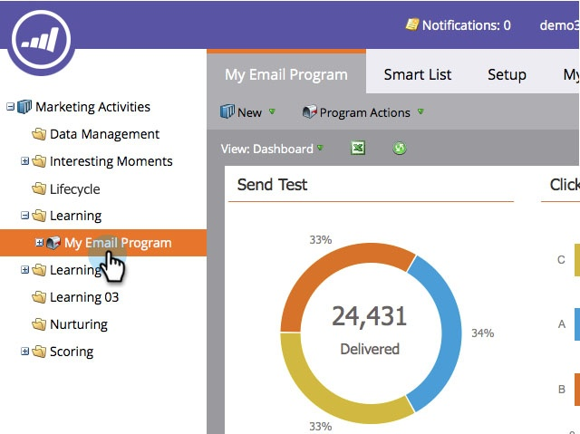

# 將電子郵件方案儀表板匯出至 Excel {#export-email-program-dashboard-to-excel}

執行電子郵件程式並在控制面板中放入一些資料後，您就可以將原始資料匯出至Excel以供進一步分析。 方法如下。

1. 前往 **[!UICONTROL Marketing Activities]**。

   

1. 尋找並選取您的電子郵件程式。

   

   >[!NOTE]
   >
   >如果您的電子郵件程式尚未開始，您不會看到控制面板，因為沒有資料可檢視。

1. 只需按一下Excel圖示，即可開始匯出。

   

   相當簡單，對吧？
