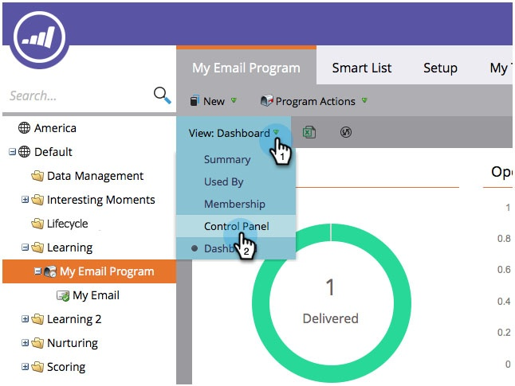
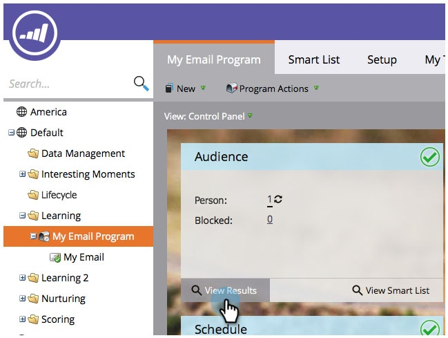
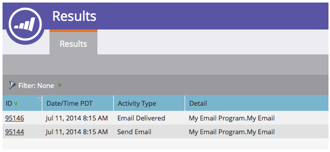

# 檢視電子郵件方案結果 {#view-email-program-results}

如同智慧行銷活動中的[!UICONTROL Results]索引標籤一樣，您可以在電子郵件方案中看到相同的資訊。

1. 前往 **[!UICONTROL Marketing Activities]**。

   

1. 尋找並選取您的電子郵件程式。

   

   >[!NOTE]
   >
   >如果電子郵件程式已執行，您將會直接進入電子郵件程式控制面板。

1. 在&#x200B;**[!UICONTROL View]**&#x200B;下，選取&#x200B;**[!UICONTROL Control Panel]**。

   

1. 在&#x200B;**[!UICONTROL Audience]**&#x200B;圖磚下，按一下&#x200B;**[!UICONTROL View Results]**。

   

   您有！

   
