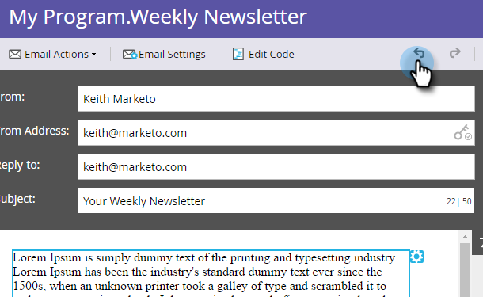
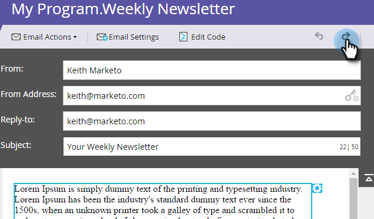

# 電子郵件編輯器中的還原 {#undo-in-the-email-editor}

1. 若要復原變更，請按一下向左鍵。

>[!TIP]
>
>復原最多可回覆50項變更。

1. 若要重做變更，請按一下向右鍵。

   

   >[!NOTE]
   >
   >編輯文字時無法還原。 完成後，您可以復原所有從第一次編輯到儲存的變更。

   很好！ 現在您可以像專業版一樣復原和重做。
