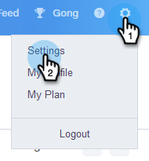
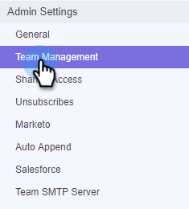
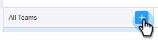
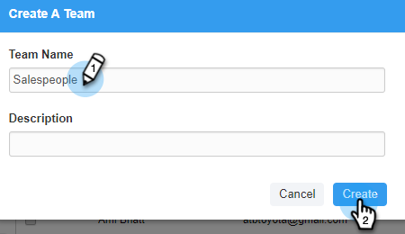
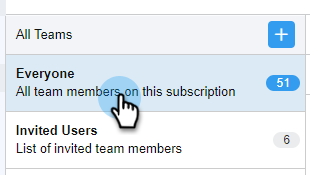
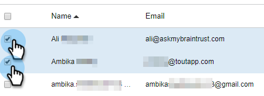
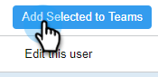
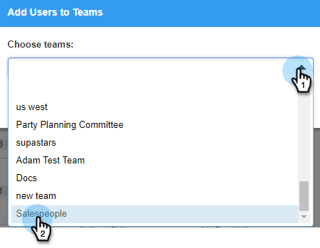
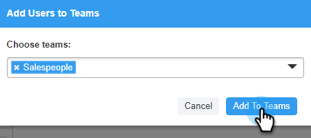

# 建立子團隊 {#create-a-sub-team}

## 建立子團隊 {#create-a-sub-team-1}

1. 按一下齒輪圖示並選取&#x200B;**[!UICONTROL Settings]**。

   

1. 在[!UICONTROL Admin Settings]下，選取&#x200B;**[!UICONTROL Team Management]**。

   

1. 在[!UICONTROL All Teams]旁邊，按一下&#x200B;**+**。

   

1. 輸入團隊名稱（和選用的說明），然後按一下&#x200B;**[!UICONTROL Create]**。

   

   >[!NOTE]
   >
   >您現在可以與該團隊共用範本、行銷活動和群組。

## 新增人員至您的子團隊 {#add-people-to-your-sub-team}

1. 仍然在[!UICONTROL Team Management]中，選取&#x200B;**[!UICONTROL Everyone]**&#x200B;群組。

   

1. 找出要新增至子團隊的使用者，並選取其核取方塊。

   

1. 按一下「**[!UICONTROL Add Selected to Teams]**」。

   

1. 按一下下拉式清單，然後選取您想要的團隊。

   

1. 完成後請按一下 **[!UICONTROL Add To Teams]**。

   
