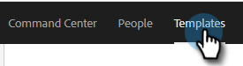
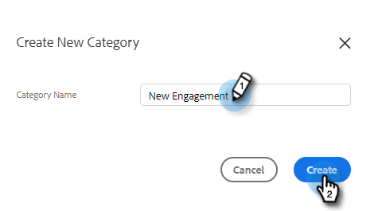
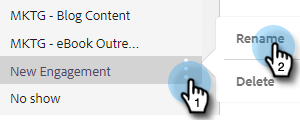
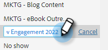
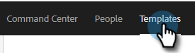
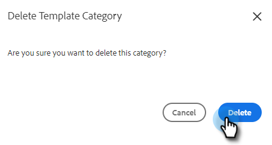

# 管理範本類別 {#manage-template-categories}

## 建立類別 {#create-a-category}

1. 按一下「**[!UICONTROL Templates]**」索引標籤。

   

1. 按一下&#x200B;**[!UICONTROL Categories]**&#x200B;旁的&#x200B;**+**&#x200B;圖示。

   

1. 輸入新類別的名稱，然後按一下&#x200B;**[!UICONTROL Create]**。

   

## 重新命名範本類別 {#rename-a-template-category}

1. 按一下「**[!UICONTROL Templates]**」索引標籤。

   

1. 將游標停留在您要重新命名的範本上，然後按一下圓點（三個點）。 選取「**[!UICONTROL Rename]**」。

   

1. 輸入新名稱。 按下Enter鍵（或按一下畫面上的其他位置）以儲存。

   

## 刪除範本類別 {#delete-a-template-category}

1. 按一下「**[!UICONTROL Templates]**」索引標籤。

   

1. 將游標停留在您要重新命名的範本上，然後按一下圓點（三個點）。 選取「**[!UICONTROL Delete]**」。

   

1. 按一下 **[!UICONTROL Delete]** 確認。

   

>[!NOTE]
>
>如果類別包含範本，則無法刪除這些類別。 在刪除類別之前移動或刪除所有範本。
