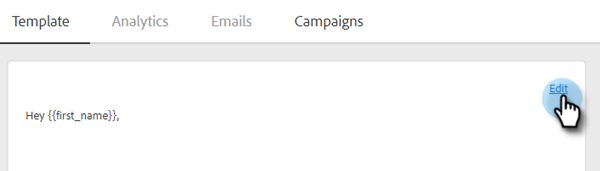
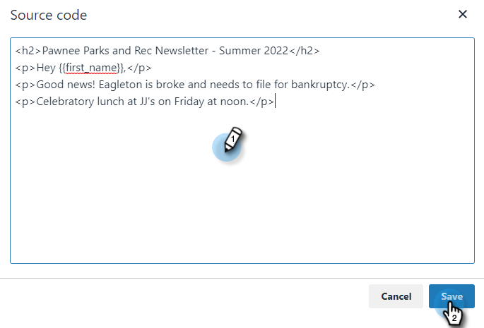

# 使用 HTML {#using-html}

1. 使用在HTML中建立電子郵件所使用的工具（例如Marketo的電子郵件編輯器），從電子郵件複製原始程式碼。

1. 選取您要新增HTML的範本。

   

1. 在範本編輯器卡片中，按一下&#x200B;**[!UICONTROL Edit]**。

   

1. 按一下範本編輯器中的&#x200B;**Source**&#x200B;按鈕。

   

1. 貼上原始程式碼並按一下&#x200B;**[!UICONTROL Save]**。

   

>[!NOTE]
>
>如果您看到「錯誤 — 移除樣式/java/html標籤」錯誤，表示您有一些我們不支援的樣式。 您應該搜尋Source程式碼中的單字樣式，並刪除從``的所有內容。
