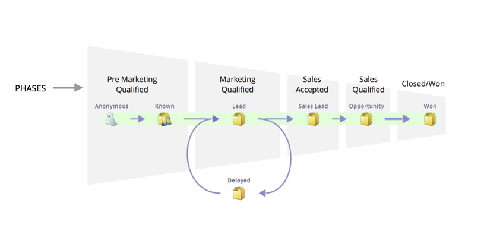
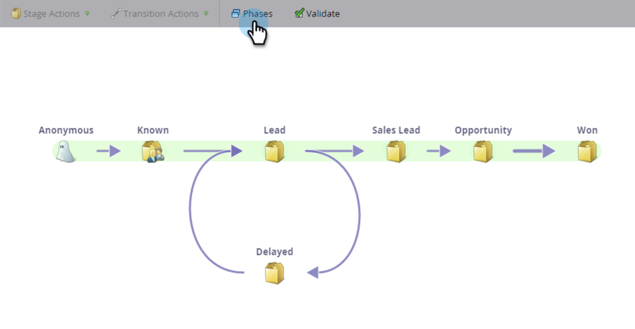

# 了解收入模型階段 {#understanding-revenue-model-phases}

階段是將多個階段群組的方法。 有時模型中的多個階段會反映funnel的一個階段。

## 定義模型的階段 {#define-the-phases-of-the-model}

1. 按一下「**[!UICONTROL Phases]**」。

   

1. 按一下藍色按鈕，在階段中上下拖曳階段。

   
