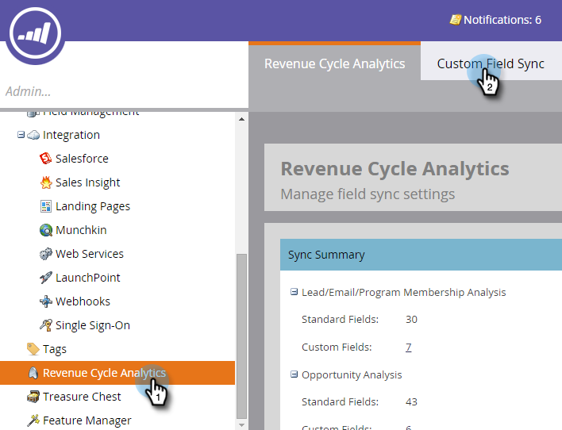
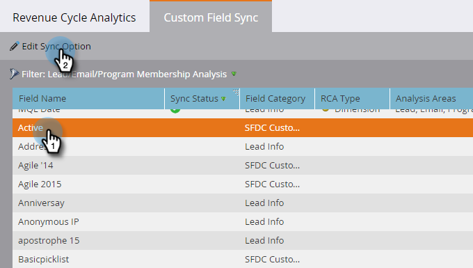
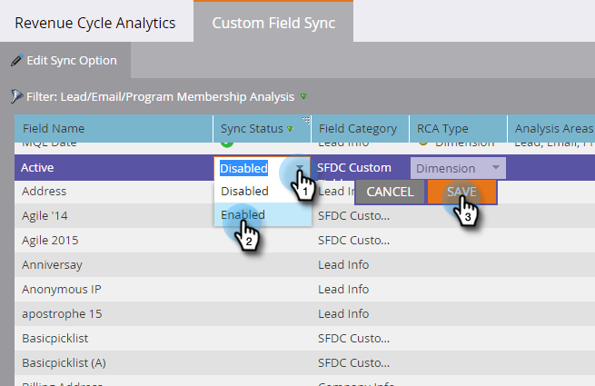
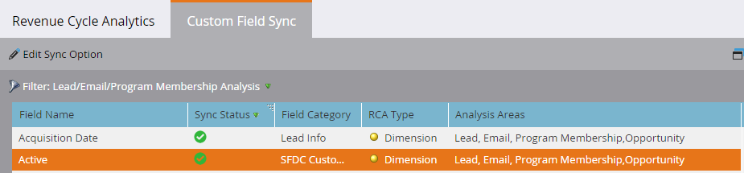

# 正在啟用[!UICONTROL Revenue Cycle Analytics]的自訂欄位同步 {#enabling-custom-field-sync-for-revenue-cycle-analytics}

下列步驟可讓您利用RCA報告中的自訂欄位。

1. 按一下「**[!UICONTROL Admin]**」。

   

1. 按一下&#x200B;**[!UICONTROL Revenue Cycle Analytics]**，然後按&#x200B;**[!UICONTROL Custom Field Sync]**。

   

1. 選取您的&#x200B;**[!UICONTROL Field Name]**，然後按一下&#x200B;**[!UICONTROL Edit Sync Option]**。

   

1. 在&#x200B;**[!UICONTROL Sync Status]**&#x200B;下，選取&#x200B;**[!UICONTROL Enabled]**，然後按一下&#x200B;**[!UICONTROL Save]**。

   

1. 綠色勾選可讓您知道欄位已設定為同步。

   

   就是這樣！

   >[!NOTE]
   >
   >啟用欄位後，資料第二天即可在[!UICONTROL Revenue Cycle Analytics]中使用。
